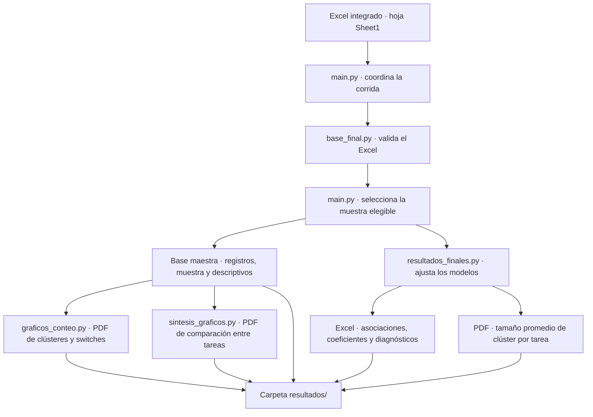

# Análisis de fluidez verbal

Código del análisis estadístico que acompaña la tesis sobre asociaciones
entre sexo, edad, escolaridad y fluidez verbal. El flujo analiza las tareas
fonológicas P y R y la tarea semántica Supermercado.

**Autor del código:** Daniel González Iturra.

## Qué calcula

- Descriptivos de la muestra y del rendimiento por tarea.
- Regresión de Poisson simple y ajustada para el número de clústeres y de
  switches. Para switches en P y R, incluye el análisis de sensibilidad
  con binomial negativa.
- Regresión lineal con errores estándar robustos HC3 para el tamaño promedio
  de clúster, incluidos los ceros registrados por ausencia de clústeres.
- Gráficos por tarea y figuras de síntesis.

## Arquitectura del código

El programa está dividido en módulos de Python. Se ejecuta únicamente
[`codigo/main.py`](codigo/main.py), que coordina las etapas en el orden
del diagrama y guarda las salidas juntas al terminar la corrida.



| Archivo | Función en el análisis |
| --- | --- |
| [`main.py`](codigo/main.py) | Recibe la ruta del Excel y la carpeta de salida. Selecciona la muestra elegible y coordina los modelos y la generación de archivos. |
| [`base_final.py`](codigo/base_final.py) | Valida encabezados y folios, forma los grupos de edad y escolaridad y genera el Excel maestro. |
| [`descriptivos.py`](codigo/descriptivos.py) | Calcula media, mediana, desviación estándar, cuartiles y extremos, además de contar valores válidos, faltantes y ceros. |
| [`modelos.py`](codigo/modelos.py) | Ajusta las regresiones de Poisson y lineal y calcula coeficientes, errores estándar robustos y diagnósticos. |
| [`modelos_conteo.py`](codigo/modelos_conteo.py) | Define las comparaciones, ajusta la binomial negativa y calcula frecuencias esperadas e indicadores como la dispersión de Pearson y el AIC. |
| [`resultados_finales.py`](codigo/resultados_finales.py) | Ejecuta los modelos de conteo por tarea y reúne en un Excel las razones, los intervalos, los coeficientes, las ecuaciones y los diagnósticos. |
| [`tamano_cluster.py`](codigo/tamano_cluster.py) | Analiza el tamaño promedio de clúster con regresión lineal y errores robustos HC3. Añade las tablas de ese análisis al Excel y genera sus PDF. |
| [`graficos_conteo.py`](codigo/graficos_conteo.py) | Lee la muestra elegible del Excel maestro y genera PDF con distribuciones, estimaciones, curvas y diagnósticos de los conteos. |
| [`graficos.py`](codigo/graficos.py) | Define las funciones compartidas para dibujar puntos, curvas, barras e intervalos. |
| [`sintesis_graficos.py`](codigo/sintesis_graficos.py) | Reúne en un PDF por medida las asociaciones ajustadas de P, R y Supermercado. |
| [`salida.py`](codigo/salida.py) | Aplica el formato común a las tablas de los Excel. |
| [`requirements.txt`](codigo/requirements.txt) | Enumera las dependencias que se instalan antes de ejecutar el programa. |

Las tablas principales comparan grupos de edad y escolaridad. Las curvas
exploratorias usan la edad y la escolaridad expresadas en años. Por eso
la dispersión de Pearson que aparece en una curva puede diferir de la
del Excel. La comparación con binomial negativa se evalúa para el modelo
que corresponde a cada salida.

## Instalación y ejecución

Se requiere Python 3.10 o posterior. Desde la raíz del repositorio, crea un entorno:

```sh
python -m venv .venv
```

En Windows, desde CMD:

```cmd
.\.venv\Scripts\python.exe -m pip install -r codigo/requirements.txt
.\.venv\Scripts\python.exe codigo/main.py --entrada "datos/base_integrada.xlsx" --salida resultados
```

En macOS o Linux:

```sh
.venv/bin/python -m pip install -r codigo/requirements.txt
.venv/bin/python codigo/main.py --entrada "datos/base_integrada.xlsx" --salida resultados
```

El argumento `--entrada` debe apuntar a tu copia autorizada de la base integrada,
con las correcciones de origen ya aplicadas. Usa una carpeta nueva en `--salida`
para cada corrida.

## Estructura de la entrada

El archivo Excel debe contener una hoja `Sheet1` con encabezados en la primera
fila y un registro por participante. Estas son las columnas requeridas:

| Contenido | Columnas |
| --- | --- |
| Identificación y selección | `id` único, `cohorte`, `cumple_criterios` (1 = incluida, 0 = excluida) |
| Características sociodemográficas | `sexo` (0 = hombre, 1 = mujer), `edad`, `escolaridad` en años |
| Antecedentes y Mini-Mental | `ant_psiq`, `ant_neuro`, `puntaje_mmse` |
| Número de clústeres | `cluster_p`, `cluster_r`, `cluster_SEM` |
| Número de switches | `switching_p`, `switching_r`, `switching_SEM` |
| Tamaño promedio de clúster | `prom_cluster_p`, `prom_cluster_r`, `prom_cluster_SEM` |

La elegibilidad se toma de la marca de la base. El programa agrupa la edad en
18–39, 40–59 y 60 años o más, y la escolaridad en hasta 12 años y más de 12 años.
Para reproducir las cifras de la tesis se requiere la base final autorizada.
La carpeta pública contiene el código. Los registros individuales y los archivos
generados a partir de ellos se manejan por separado.

## Archivos generados

La carpeta predeterminada es `resultados/`.

| Salida | Contenido |
| --- | --- |
| `01_base_maestra_fluidez.xlsx` | Registros completos, muestra elegible, descriptivos y cruce con Mini-Mental |
| `02_resultados_regresiones.xlsx` | Comparaciones, coeficientes, ecuaciones y diagnósticos |
| `P/`, `R/`, `Supermercado/` | PDF de conteos y tamaño promedio, en subcarpetas separadas |
| `Sintesis/` | PDF comparativos de las tres tareas |

## Descargar el código como ZIP

1. Abre la [página principal del repositorio](https://github.com/Daanniieell2025/fluidez-verbal-tesis).
2. Sobre la lista de archivos, pulsa **Code** y luego **Download ZIP**.
   También puedes usar el [enlace de descarga directa](https://github.com/Daanniieell2025/fluidez-verbal-tesis/archive/refs/heads/main.zip).
3. En Windows, haz clic derecho sobre el ZIP y selecciona **Extraer todo**.
4. Abre la carpeta extraída que contiene `README.md` y `codigo/`.
   Para abrir CMD en esa ubicación, escribe `cmd` en la barra de direcciones
   del Explorador de archivos y presiona **Enter**.
5. Crea la carpeta `datos/` y coloca allí tu copia autorizada del Excel.
   Sigue los pasos de [instalación y ejecución](#instalación-y-ejecución)
   y usa en `--entrada` el nombre real de tu archivo.
